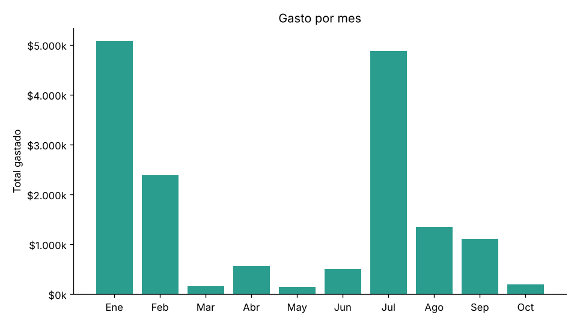
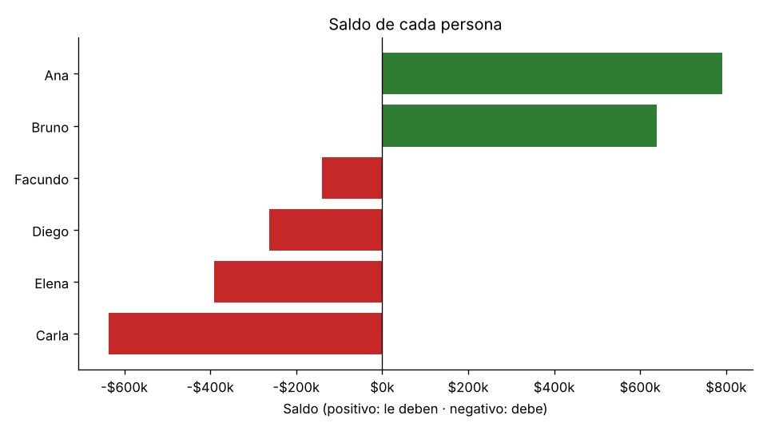
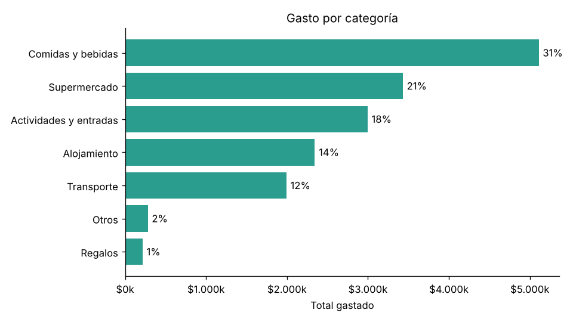

# Divisor de gastos compartidos

**Autor:** Daniel Chacón
**Materia:** Programación Orientada a Datos, Licenciatura en Ciencia de Datos (UCA, Campus Rosario), 2026
**Trabajo:** TP2 individual

Aplicación de consola en Python para un grupo de amigos que comparte gastos a lo largo del año: viajes, asados, cumpleaños, salidas. Lee los gastos desde **CSV o JSON**, aparta los mal cargados explicando por qué, y responde lo que el grupo necesita saber:

- **quién le tiene que transferir a quién** para quedar a mano, en todo el año o en un evento puntual;
- **en qué se fue la plata**: por evento, por categoría y por mes;
- **cuánto puso y cuánto consumió cada uno**;
- **cuántas transferencias se ahorran** organizando las cuentas con el programa.

Se usa con un **menú interactivo** o con **comandos**, muestra todo en tablas con colores gracias a la librería [rich](https://github.com/Textualize/rich) y genera **gráficos** con matplotlib.

| Gasto por mes | Saldo de cada persona |
|---|---|
|  |  |

## 1. Problema, usuario y solución

**Problema.** Cuando un grupo comparte gastos durante meses, cada persona paga cosas distintas y no siempre para todos (un café para dos, un remis para tres, la cabaña para cinco). Cerrar las cuentas a mano es lento y se cometen errores: gastos cargados dos veces, montos mal escritos, gente que no estaba. Además, si cada uno le devuelve a cada pagador lo de cada gasto, terminan haciéndose cientos de transferencias.

**Usuario.** La persona que organiza los gastos del grupo y quiere cerrar las cuentas de forma clara y verificable, y entender en qué se gastó.

**Solución.** El programa:

1. lee los gastos de un archivo CSV o JSON;
2. valida cada gasto (id, fecha, evento, categoría, monto e integrantes) y aparta los que tienen errores, **con su motivo**;
3. reparte cada gasto en partes iguales y calcula el saldo de cada persona (lo que pagó menos lo que consumió);
4. propone las transferencias para saldar todo (como máximo, una menos que la cantidad de personas);
5. calcula estadísticas, **escribe conclusiones automáticamente** y dibuja gráficos;
6. verifica que las cuentas cierren y guarda los resultados en archivos.

**Alcance de esta versión.** Los gastos se dividen **en partes iguales** y en **una sola moneda (pesos)**. Quedan fuera los repartos por porcentaje, las monedas múltiples y los pagos parciales ya hechos entre integrantes.

## 2. Instalación

Requisitos: **Python 3.10 o superior**.

```bash
git clone https://github.com/daniichaconn/tp2-chacon.git
cd tp2-chacon
pip install -r requirements.txt
```

Las dependencias externas son **rich**, que dibuja las tablas, los colores y el menú, y **matplotlib**, que hace los gráficos (la vimos en la Clase 3). Si `pip` no se reconoce, en Windows se usa `py -m pip install -r requirements.txt`.

## 3. Modo de uso

### Menú interactivo

```bash
python src/main.py
```

```
╭───────────────────────────── Menú ──────────────────────────────╮
│  1  Resumen del año: saldos y transferencias                    │
│  2  Cerrar las cuentas de un evento                             │
│  3  Estadísticas y conclusiones del año                         │
│  4  Estadísticas de un evento                                   │
│  5  Detalle de una persona                                      │
│  6  Comparar transferencias: sin organizar vs. con el programa  │
│  7  Ver gastos rechazados                                       │
│  8  Generar gráficos (imágenes PNG)                             │
│  9  Exportar todos los resultados a la carpeta outputs          │
│  0  Salir                                                       │
╰─────────────────────────────────────────────────────────────────╯
```

Los eventos y las personas se eligen **por número de una lista**, así no hay nombres mal escritos. Si se escribe una opción que no existe, el programa lo avisa y vuelve a preguntar.

### Comandos

| Para… | Comando |
|---|---|
| Saldos y transferencias de todo el año | `python src/main.py resumen` |
| Cerrar las cuentas de un evento | `python src/main.py resumen --evento bariloche` |
| Cerrar las cuentas de un período | `python src/main.py resumen --desde 2026-07-01 --hasta 2026-08-31` |
| Estadísticas y conclusiones | `python src/main.py estadisticas` |
| Estadísticas de un evento | `python src/main.py estadisticas --evento cordoba` |
| Una persona, evento por evento | `python src/main.py persona Ana` |
| Cada gasto de una persona en un evento | `python src/main.py persona Ana --evento recital` |
| Comparar transferencias | `python src/main.py comparar` |
| Lista de eventos | `python src/main.py eventos` |
| Filas rechazadas y su motivo | `python src/main.py rechazados` |
| Gráficos PNG (del año o de un evento) | `python src/main.py graficos` o `graficos --evento bariloche` |
| Leer el JSON en lugar del CSV | agregar `--datos data/gastos.json` a cualquier comando |
| Ayuda | `python src/main.py --help` o `python src/main.py resumen --help` |

En `--evento` alcanza con una parte del nombre, sin importar mayúsculas ni tildes: `cordoba` encuentra *Finde largo en Córdoba*. Si la parte coincide con más de un evento (por ejemplo, `cumple`), el programa no elige al azar: avisa cuáles coinciden y pide algo más específico. Lo mismo pasa con los nombres: `bruno` encuentra a *Bruno*.

En macOS o Linux puede ser necesario escribir `python3` en lugar de `python`.

### Archivos que genera

Se guardan en `outputs/`, o en la carpeta indicada con `--salida`:

| Archivo | Contenido | Lo genera |
|---|---|---|
| `saldos.csv` | lo que pagó, consumió y el saldo de cada persona | `resumen` |
| `transferencias.csv` | quién le paga a quién, cuánto y a qué alias | `resumen` |
| `rechazados.csv` | filas descartadas con su motivo | `resumen` |
| `eventos.csv`, `categorias.csv`, `meses.csv` | las tablas de estadísticas | `estadisticas` |
| `conclusiones.txt` | las conclusiones escritas | `estadisticas` |
| `graficos/categorias.png`, `meses.png`, `saldos.png` | los gráficos | `graficos` |

## 4. Datos

- **Origen:** datos **simulados** generados por `scripts/generar_datos.py`, con semilla fija (`2026`) para que sean reproducibles. Representan los gastos de seis amigos de enero a octubre de 2026. Las personas, los alias y los montos son inventados.
- **Licencia:** creados para este trabajo; se pueden usar libremente.
- **Unidad de análisis:** cada fila es **un gasto** pagado por una persona, perteneciente a un evento y compartido por uno o más integrantes.
- **Tamaño:** 318 filas (306 gastos correctos y 12 con errores puestos a propósito) en 8 eventos: vacaciones en Mar del Plata, finde en Córdoba, asados mensuales, dos cumpleaños, las juntadas para ver a Argentina en el Mundial 2026, un viaje a Bariloche y un recital.
- **Variables:** `gasto_id`, `fecha`, `evento`, `categoria`, `descripcion`, `pagador`, `monto` (en pesos) y `participantes`. El detalle de cada una y de cada evento está en [`data/README.md`](data/README.md).
- **Configuración del grupo:** `data/grupo.json` contiene el nombre del grupo y el alias de transferencia de cada integrante.

Para volver a generar los datos: `python scripts/generar_datos.py`.

## 5. Organización del código

```
tp2-chacon/
|-- README.md
|-- requirements.txt
|-- .gitignore
|-- src/
|   |-- main.py          # menú, comandos y coordinación (clase Sesion)
|   |-- fuentes.py       # FuenteDatos (clase base) + FuenteCSV y FuenteJSON
|   |-- dominio.py       # clases Gasto y Grupo: reparto, saldos y transferencias
|   |-- pipeline.py      # validar -> limpiar -> filtrar -> calcular -> verificar -> guardar
|   |-- estadisticas.py  # estadísticas, comparación y conclusiones (solo datos)
|   |-- vista.py         # tablas, paneles y colores con rich (solo dibuja)
|   '-- graficos.py      # gráficos PNG con matplotlib
|-- tests/               # 81 pruebas con unittest
|-- docs/graficos/       # gráficos que se muestran en este README
|-- data/                # datos de ejemplo (CSV, JSON, grupo) y su documentación
'-- scripts/
    '-- generar_datos.py
```

**Flujo de un comando:**

```
filas = fuente.cargar()                              # CSV o JSON -> misma representación
validar_esquema(filas)                               # ¿hay datos? ¿están todas las columnas?
validos, rechazados = limpiar_gastos(filas, grupo)   # fila por fila, con motivo de rechazo
gastos = filtrar_periodo(filtrar_evento(validos, evento), desde, hasta)
grupo, resumen, transferencias = calcular(...)       # registra, calcula y VERIFICA
estadisticas.por_evento(gastos) ...                  # números
vista.tabla_eventos(console, ...)                    # dibujo
```

**Decisiones de diseño:**

- **Abstracción de las fuentes.** `FuenteDatos` es una clase abstracta con el método `cargar()`. `FuenteCSV` y `FuenteJSON` lo implementan y devuelven lo mismo, así que el resto del programa no sabe ni le importa de qué formato vino el dato (polimorfismo).
- **Clases del dominio.** `Gasto` (una `dataclass` inmutable) sabe repartirse entre sus participantes. `Grupo` guarda integrantes y gastos, y calcula saldos, transferencias y las deudas "sin organizar" para la comparación.
- **Separar cálculo y presentación.** `estadisticas.py` solo devuelve números; `vista.py` (terminal) y `graficos.py` (imágenes) solo los presentan. Los mismos números se muestran de dos formas sin repetir cálculos, y se pueden probar sin mirar la pantalla.
- **Composición.** `Sesion` (en `main.py`) carga los datos una vez y los reutiliza en cada opción del menú, en lugar de leer el archivo cada vez.
- **Plata en centavos enteros.** Todos los importes se guardan como `int` en centavos, porque con `float` aparecen errores de redondeo (`0.1 + 0.2` da `0.30000000000000004`). Los centavos que sobran al dividir se asignan de a uno, así **la suma de las partes es siempre igual al total**.
- **Funciones sin efectos secundarios.** La limpieza, los cálculos y las estadísticas no modifican la entrada ni escriben archivos; solo leer y guardar tocan el disco.

## 6. Expresiones regulares y validaciones

| Campo | Patrón o regla | Qué valida |
|---|---|---|
| `gasto_id` | `G\d{3}` | una G seguida de 3 dígitos (G001) |
| `fecha` | `\d{4}-\d{2}-\d{2}` + `datetime.strptime` | formato AAAA-MM-DD **y** que la fecha exista en el calendario |
| `monto` | `\d+(\.\d{1,2})?` | número positivo, punto decimal y hasta 2 decimales |
| alias | `[a-z0-9.\-]{6,20}` | alias de transferencia: 6 a 20 minúsculas, números, puntos o guiones |
| `categoria` | lista cerrada de 7 categorías | que se pueda agrupar sin variantes ("super", "Súper", ...) |
| `evento` | no vacío | que todo gasto pertenezca a algo |

Se usa `re.fullmatch`, que exige que **todo** el texto cumpla el patrón. Una regex solo controla la *forma*: `2026-02-29` cumple el patrón pero no existe. Por eso, después de la regex, la fecha se convierte con `datetime.strptime`, que conoce el calendario y los años bisiestos.

## 7. Ejemplos de resultado

**Cerrar las cuentas de un evento:** `python src/main.py resumen --evento mar`

```
Transferencias para quedar a mano
╭───┬───────┬───┬────────┬──────────────┬──────────────────╮
│ # │ Paga  │   │ Recibe │        Monto │ Alias de destino │
├───┼───────┼───┼────────┼──────────────┼──────────────────┤
│ 1 │ Diego │ → │ Ana    │ $ 660.394,05 │ ana.viaja.mp     │
│ 2 │ Carla │ → │ Ana    │ $ 264.449,35 │ ana.viaja.mp     │
│ 3 │ Carla │ → │ Elena  │ $ 146.333,36 │ elena.pagos      │
│ 4 │ Bruno │ → │ Elena  │  $ 12.290,86 │ elena.pagos      │
╰───┴───────┴───┴────────┴──────────────┴──────────────────╯
         4 transferencias · $ 1.083.467,62 en total
```

**Conclusiones del año:** `python src/main.py estadisticas` (fragmento)

```
1. Se registraron 305 gastos por $16.369.151 entre el 12 de enero y el 25 de octubre (promedio $53.669 por gasto).
2. El evento con más gasto fue Viaje a Bariloche: $5.172.404, el 32% del total.
3. Comidas y bebidas es la categoría que más pesa: 31% del total en 121 gastos.
4. El mes de mayor gasto fue enero 2026 ($5.075.638), sobre todo por Vacaciones en Mar del Plata.
5. Ana fue quien más plata adelantó: $3.798.178 (23% de todo lo pagado).
8. Pagando cada gasto por separado harían falta 922 transferencias; con el programa alcanzan 5 (99% menos).
```

**Cómo se interpreta.** En Mar del Plata, Ana pagó el departamento, así que es la que más tiene que cobrar. Con 4 transferencias los 5 quedan a mano. En todo el año, si cada uno le devolviera a cada pagador su parte de cada gasto, harían falta 922 transferencias; compensando saldos alcanzan 5.

**Gráfico por categoría:** `python src/main.py graficos`



**La comparación de transferencias** cuenta tres formas de cerrar las cuentas:

1. **Sin organizar:** cada participante le paga su parte al pagador de cada gasto.
2. **Por pares:** se compensan las deudas entre cada par de personas.
3. **Con el programa:** se calcula el saldo de cada uno y el que más debe le paga al que más tiene que cobrar.

## 8. Decisiones de limpieza

Una fila se **rechaza entera** si tiene al menos un problema. Se informa con todos sus motivos (opción 7 del menú y `rechazados.csv`):

| Problema | Ejemplo en los datos | Decisión |
|---|---|---|
| id con formato inválido | `G12` | rechazar |
| id repetido | `G041` cargado dos veces | rechazar **las dos** filas: no se sabe cuál es la buena |
| fecha inexistente o con otro formato | `2026-02-30`, `15/03/2026` | rechazar |
| monto inválido | `1.500,00`, `-2500`, `0` | rechazar (no se adivina qué quiso escribir) |
| persona fuera del grupo | pagador `Mateo` | rechazar |
| sin participantes o repetidos | `Ana;Ana;Bruno` | rechazar |
| categoría desconocida | `Varios` | rechazar e informar las categorías válidas |
| evento vacío | — | rechazar |

El programa **se detiene con un mensaje claro** si el archivo no existe, si el JSON está mal formado o no es una lista de objetos, si faltan columnas, si no hay datos válidos, si el período está invertido, o si un evento o una persona no existen o son ambiguos.

**Verificaciones del resultado,** que deben cumplirse siempre:

- la suma de los saldos es exactamente 0;
- lo consumido suma el total gastado;
- aplicando las transferencias, todos quedan en 0;
- hay como máximo (personas − 1) transferencias.

## 9. Pruebas

```bash
python -m unittest discover -s tests -v
```

Hay 81 pruebas en 6 archivos:

- **casos normales:** reparto exacto; saldos, estadísticas y transferencias de casos calculados a mano;
- **entradas inválidas y límites:**
  - cada regla de rechazo;
  - el 29/02 en año bisiesto y no bisiesto;
  - eventos ambiguos o inexistentes;
  - archivo inexistente y JSON roto;
  - una opción inválida en el menú;
- **propiedades:**
  - los saldos suman 0, en todo el año y en **cada evento por separado**;
  - las transferencias dejan a todos en 0;
  - los totales por evento, por categoría, por mes y por persona dan **el mismo total**;
  - los porcentajes suman 100;
  - CSV y JSON producen exactamente el mismo resultado;
  - entrada = válidos + rechazados.

El menú también se prueba solo: las pruebas le "escriben" opciones simuladas y revisan lo que muestra. Los gráficos se prueban comprobando que se generen archivos PNG válidos.

## 10. Limitaciones

- Reparto solo en partes iguales y en una sola moneda.
- El método de transferencias garantiza como máximo n − 1, pero **no siempre el mínimo absoluto**: encontrar siempre la cantidad mínima es un problema mucho más costoso de calcular, y para grupos chicos esta aproximación alcanza.
- La regex del alias controla el formato, no que el alias exista.
- Los datos de ejemplo son simulados: sirven para demostrar y probar el programa, no describen gastos reales.

## Versiones

| Etiqueta | Contenido |
|---|---|
| `v1.0` | primera entrega: un viaje, saldos y transferencias |
| `v2.0` | **versión evaluada**: un año de eventos con categorías, estadísticas, conclusiones, gráficos, comparación de transferencias y menú interactivo |
